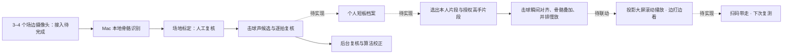

Badminton Mirror Coach is an "AI assistant coach" for badminton halls, built from cameras, a Mac and a projector screen.<br>
It keeps a weakness profile for each amateur player and, while they play, keeps showing their key weaknesses next to an expert performing the same stroke, aligned at the moment of contact and slowed down.<br>
No on-site coach is needed: the AI selects what to show, and back-office staff review footage to keep improving the analysis.<br>
Pose extraction, court calibration, hit-sound candidates, manual review and the comparison renderer exist today; detailed analysis has been validated on one rally of a public match.<br>
Weakness profiles, live camera input, delayed replay and QR hand-off are the 48-hour goals; no footage is distributed here.

# 羽毛球对镜陪练

**场边摄像头加大屏，边打边看你和高手的差距。**

当前版本仍需离线分析和人工复核，详见「已经做到哪一步」。

## 为什么做

我是业余羽毛球教练。中羽 4 到 6 级的业余高手基础动作都没问题，难的是进一步提高：看不清自己的实际动作，不知道和高手差在哪，私教又贵。

## 怎么做

在球馆场边装 3 到 4 个**摄像头**，对面装**投影大屏**，连上 **Mac**，做一名不占编制的「AI 助教」：

1. 系统为每位球友建立**短板档案**。
2. 球友正常打球，Mac 本地用骨骼识别和击球声分析每一拍。
3. AI 结合档案和他最近的动作，在大屏**滚动播放他最该补的问题**：本人动作与高手同一动作在击球瞬间对齐、并排慢放，**边打边看边改**。
4. **现场无需教练**：AI 挑选内容；后台人员根据现场录像不断校正算法，提高准确度和相关性。早期 AI 的判断经后台复核后再上屏。
5. 球友扫码把记录带回手机，档案随每次训练更新，下次复测看进步。

场边围观的球友也会被吸引，装了这套设施的场地能提高租金；日后可做成供业余高手约战和提高的**无人值守球馆**。摄像头便宜稳定，可定制成专用套件。



当前仓库提供分析流水线和独立的对比渲染脚本；虚线部分是 48 小时及之后要接通的环节。

## 已经做到哪一步

- 标准流水线于 **2026-10-07 验收**：含场地标定和逐拍复核两个网页，能输出跑位图、节奏图和结构化报告素材。
- **68 秒视频在 Mac mini M4 上约需 3.4 分钟**计算；不含人工复核与对比样片渲染时间。这是既有环境实测，不能视为现场响应承诺。
- 单回合样本场地标定误差约 **6 厘米**；这是标定交点的误差，不等于每帧身体位置的测量精度。
- 对比渲染脚本已有触球对齐、慢放、骨骼叠加、往复和并排播放逻辑。当前片段、触球时间及裁切范围需手工指定。

方法和指标可信度见 [方法说明](docs/method.md)；已知问题见 [局限](docs/limitations.md)。早期脚本因击球误报和固定建议未收录。分析报告和训练计划仍由人工结合素材撰写，仓库不自动生成教练结论。

## 快速开始

在仓库根目录运行。建议使用原笔记中的 Python **3.12**，先安装 [uv](https://docs.astral.sh/uv/getting-started/installation/) 和系统 ffmpeg；可用 `BADMINTON_FFMPEG`、`BADMINTON_FFPROBE` 指定工具路径。

```bash
uv venv --python 3.12 .venv
uv pip install -r requirements.txt
# 仅检查入口，不需要素材或模型
.venv/bin/python pipeline/run.py --help

# 从官方模型地址下载；模型留在本地，不提交仓库
curl -fL -o pose_landmarker_heavy.task \
  https://storage.googleapis.com/mediapipe-models/pose_landmarker/pose_landmarker_heavy/float16/latest/pose_landmarker_heavy.task

# 自行放入视频；需要音轨（或用 --audio 指定独立音频）
.venv/bin/python pipeline/run.py new videos/session.mp4 --name demo --player player_a
# 编辑 runs/demo/meta.toml，示例见 examples/meta.example.toml
.venv/bin/python pipeline/run.py run demo
```

模型来源与加载方式见 [MediaPipe 官方指南](https://ai.google.dev/edge/mediapipe/solutions/vision/pose_landmarker/python)。

流水线在人工复核点暂停时，在另一个终端启动服务：

```bash
.venv/bin/python pipeline/review_server.py demo
# 浏览器打开 http://localhost:8765，完成当前复核并保存
# 然后重新运行流水线；遇到下一个复核点重复此过程
.venv/bin/python pipeline/run.py run demo
.venv/bin/python pipeline/run.py status demo
```

可选：设置 `BADMINTON_FONT` 为本地中文字体路径以绘制中文图表。若 PATH 中没有 ffmpeg，代码会尝试 imageio-ffmpeg 自带的版本。

对比渲染使用独立配置，需要自行提供视频和中文字体：

```bash
# 先按素材修改 examples/compare.example.toml
.venv/bin/python compare/render_compare.py \
  --config examples/compare.example.toml \
  --font fonts/chinese.ttc --output comparison.mp4
```

此脚本保留旧版 `mp.solutions.pose` 接口，因此依赖限定了兼容区间；例子的裁切布局及全身片段窗口仍是原样片专用，不保证任意视频可直接套用。本次本地整理只验证了编译、入口和接口兼容，未重新进行带视频的全流程验证。

## 样片

演示样片含第三方比赛画面，仅通过网盘向评审提供，不在仓库发布。

此处不含网盘链接、第三方视频、截图或模型。公开可观看不代表取得素材授权；正式高手动作库计划使用授权或教练自录素材。

## 局限与下一步

详细分析只在公开比赛视频的**一个回合**上验证过，还没分析用户本人的比赛。击球检测需人工复核；遮挡、挥拍手臂丢失和观众误检会影响结果。高手动作库目前没有授权素材，自动挑关键动作、大屏联动均未完成。

**48 小时计划**：交付「摄像头 + Mac + 大屏」联动原型（比赛现场用手机临时充当机位）：为一位球友建立短板档案，大屏滚动播放他的短板与高手同一动作的对齐慢放，并实时延时回放刚才的画面；附后台复核页面，可修正 AI 判断。现场没有球场时，选手原地挥拍、走上网步法做演示，大屏当场显示对比并可扫码带走；另备真实球馆录像兜底。「根据最近动作实时挑内容」是之后的目标；摄像头实测 30fps，定制硬件需提高帧率；高手片段使用授权或教练自录素材。

## 许可

代码与原创文档使用 [MIT License](LICENSE)。第三方依赖、模型及素材各自遵循其许可；本仓库的许可不授予第三方比赛画面的使用权。
