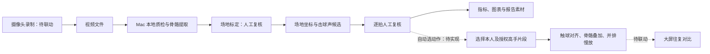

Badminton Mirror Coach helps amateur players see how their movements differ from expert demonstrations.<br>
It pairs local video analysis with contact-aligned slow-motion comparison.<br>
The prototype includes pose extraction, court calibration, audio hit candidates, and manual review.<br>
Detailed analysis has been validated on one rally from a public match video.<br>
Automatic action selection and camera-to-screen integration are planned; footage is not distributed here.

# 羽毛球对镜陪练

**打 3 分钟、看 1 分钟——把你的动作和高手的同一动作并排慢放。**

这是陪练产品的目标节奏，当前版本仍需离线分析和人工复核。

## 为什么做

我是业余羽毛球教练。中羽四五级的爱好者想打到六七级，常常看不见自己的实际动作，也不知道和高手差在哪。希望让球友在场边直接看到同一动作的对比，再带着一个具体改进点回到球场练习。

## 怎么做

目标链路是摄像头录制、Mac 本地分析、大屏往复对比。当前仓库提供分析流水线和独立的对比渲染脚本，设备联动尚待接通。



## 已经做到哪一步

- 标准流水线于 **2026-10-07 验收**：含场地标定和逐拍复核两个网页，能输出跑位图、节奏图和结构化报告素材。
- **68 秒视频在 Mac mini M4 上约需 3.4 分钟**计算；不含人工复核与对比样片渲染时间。这是既有环境实测，不能视为现场响应承诺。
- 单回合样本场地标定误差约 **6 厘米**；这是标定交点的误差，不等于每帧身体位置的测量精度。
- 对比渲染脚本已有触球对齐、慢放、骨骼叠加、往复和并排播放逻辑。当前片段、触球时间及裁切范围需手工指定。

方法和指标可信度见 [方法说明](docs/method.md)；已知问题见 [局限](docs/limitations.md)。早期脚本因击球误报和固定建议未收录。分析报告和训练计划仍由人工结合素材撰写，仓库不自动生成教练结论。

## 快速开始

在仓库根目录运行。建议使用原笔记中的 Python **3.12**，先安装 [uv](https://docs.astral.sh/uv/getting-started/installation/) 和系统 ffmpeg；可用 `BADMINTON_FFMPEG`、`BADMINTON_FFPROBE` 指定工具路径。

```bash
uv venv --python 3.12 .venv
uv pip install -r requirements.txt
# 仅检查入口，不需要素材或模型
.venv/bin/python pipeline/run.py --help

# 从官方模型地址下载；模型留在本地，不提交仓库
curl -fL -o pose_landmarker_heavy.task \
  https://storage.googleapis.com/mediapipe-models/pose_landmarker/pose_landmarker_heavy/float16/latest/pose_landmarker_heavy.task

# 自行放入视频；需要音轨（或用 --audio 指定独立音频）
.venv/bin/python pipeline/run.py new videos/session.mp4 --name demo --player player_a
# 编辑 runs/demo/meta.toml，示例见 examples/meta.example.toml
.venv/bin/python pipeline/run.py run demo
```

模型来源与加载方式见 [MediaPipe 官方指南](https://ai.google.dev/edge/mediapipe/solutions/vision/pose_landmarker/python)。

流水线在人工复核点暂停时，在另一个终端启动服务：

```bash
.venv/bin/python pipeline/review_server.py demo
# 浏览器打开 http://localhost:8765，完成当前复核并保存
# 然后重新运行流水线；遇到下一个复核点重复此过程
.venv/bin/python pipeline/run.py run demo
.venv/bin/python pipeline/run.py status demo
```

可选：设置 `BADMINTON_FONT` 为本地中文字体路径以绘制中文图表。若 PATH 中没有 ffmpeg，代码会尝试 imageio-ffmpeg 自带的版本。

对比渲染使用独立配置，需要自行提供视频和中文字体：

```bash
# 先按素材修改 examples/compare.example.toml
.venv/bin/python compare/render_compare.py \
  --config examples/compare.example.toml \
  --font fonts/chinese.ttc --output comparison.mp4
```

此脚本保留旧版 `mp.solutions.pose` 接口，因此依赖限定了兼容区间；例子的裁切布局及全身片段窗口仍是原样片专用，不保证任意视频可直接套用。本次本地整理只验证了编译、入口和接口兼容，未重新进行带视频的全流程验证。

## 样片

演示样片含第三方比赛画面，仅通过网盘向评审提供，不在仓库发布。

此处不含网盘链接、第三方视频、截图或模型。公开可观看不代表取得素材授权；正式高手动作库计划使用授权或教练自录素材。

## 局限与下一步

详细分析只在公开比赛视频的**一个回合**上验证过，还没分析用户本人的比赛。击球检测需人工复核；遮挡、挥拍手臂丢失和观众误检会影响结果。高手动作库目前没有授权素材，自动挑关键动作、大屏联动均未完成。

**48 小时计划**：先准备授权或自录的高远球、杀球、上网等小型动作库；接通「摄像头 → Mac → 大屏」，录制后自动挑关键动作并与高手片段触球对齐、往复慢放。目标是评委现场挥拍后 **1 分钟内**看到对比，尚未达到；现有耗时和人工复核说明仍需缩短链路。

## 许可

代码与原创文档使用 [MIT License](LICENSE)。第三方依赖、模型及素材各自遵循其许可；本仓库的许可不授予第三方比赛画面的使用权。
